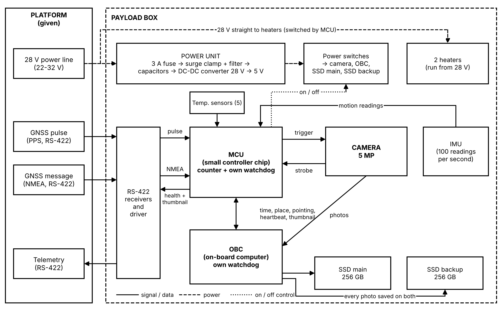
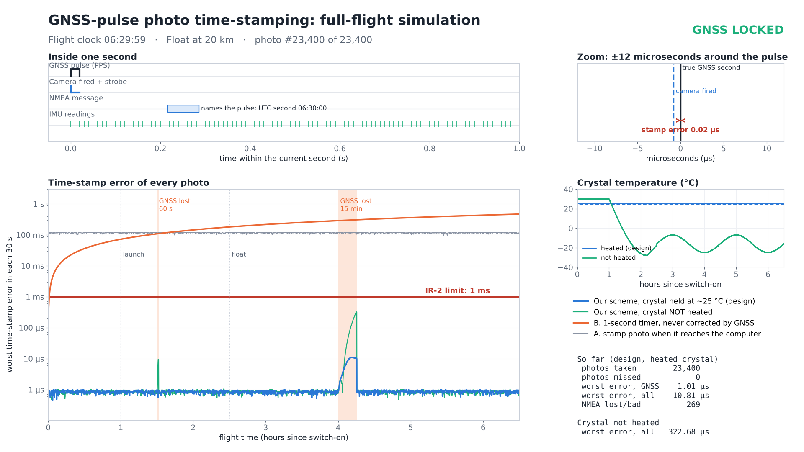

# GNSS/PPS photo time-stamping: simulations of my timing scheme


https://github.com/user-attachments/assets/0bf0c246-3c0c-46d4-b209-aae40b27eef9


This repo tests the timing scheme from my design assessment for the **Payload Integration and Testing Intern** role at Digantara. The task was a balloon imaging payload that time-stamps every photo to within **1 ms** of UTC using a GNSS receiver (PPS pulse + NMEA time).

**The scheme in one paragraph:** The MCU timer captures every PPS pulse and measures **N**, the number of ticks in one real second, averaged over the last 16 pulses. The camera is fired in hardware at the tick where the next pulse is expected (last pulse + N), so no delay is added. If the pulse arrives within ±1 ms, the MCU locks to it. If it is missing, the photo is already taken and the MCU keeps firing on N. Each photo is labelled with the UTC second from the NMEA message that follows its pulse, or last + 1 if that message is lost.
Stamp = UTC second + (strobe tick − pulse tick) / N.

## 0. System design → [`docs/DESIGN.md`](docs/DESIGN.md)
The full payload design behind these simulations: block diagram, timing error budget, data/storage and telemetry budgets, single-fault handling, power budget, thermal design and the test plan, with every calculation shown.



## 1. Microcontroller simulation (Wokwi) → [`wokwi/`](wokwi/)
A Raspberry Pi Pico runs the scheme in C. A simulated GNSS chip sends it PPS and NMEA, and a switch cuts GNSS. It shows the logic working:
- The camera fires within about 2 µs of each pulse.
- With GNSS switched off, photos keep coming every second, timed on N.
- When GNSS returns, the pulse lands 0 µs from the prediction and the MCU's own count of the second matches GNSS.

Live project (press play, flip the switch to cut GNSS): **https://wokwi.com/projects/480926110963710977**

## 2. Full-mission timing simulation (Python) → [`python/`](python/)
This simulates every photo of the mission: 1 h powered on the ground plus the required 5.5 h of ascent and float. It includes crystal drift, temperature, NMEA loss and two GNSS outages (60 s and 15 min).

| Case | Worst stamp error |
|---|---|
| GNSS present | 1.0 µs |
| 60 s outage, heated crystal | 0.7 µs |
| 15 min outage, heated crystal | 10.8 µs |
| 15 min outage, crystal not heated | 323 µs |
| 1-second timer never corrected by GNSS | > 1 ms after 51 s |
| Stamping on arrival at the computer | 20–120 ms |

Requirement: 1 ms.

Video (47 s): [`media/gnss_timing_simulation.mp4`](media/gnss_timing_simulation.mp4)



## Run it
```
pip install numpy matplotlib
cd python
python3 sim.py          # prints the results
python3 make_video.py   # renders the video (needs ffmpeg)
```
For the Wokwi version, open a new Pi Pico project on wokwi.com, upload the four files in `wokwi/`, and press play.

## Credits
Timing scheme and design: Kuppala Sarath Narendra (B.Tech Electronics & Instrumentation, NIT Agartala).
Simulation code was written with help from Claude (Anthropic) so the design could be tested quickly.
