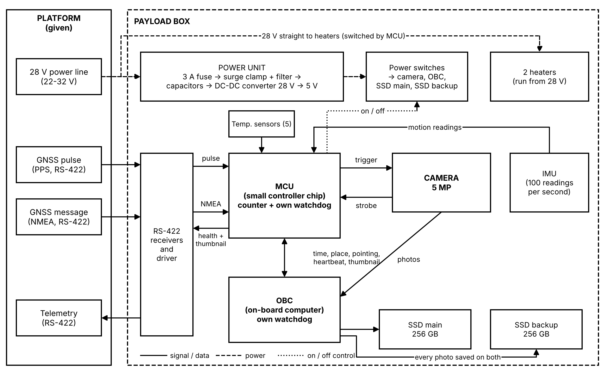
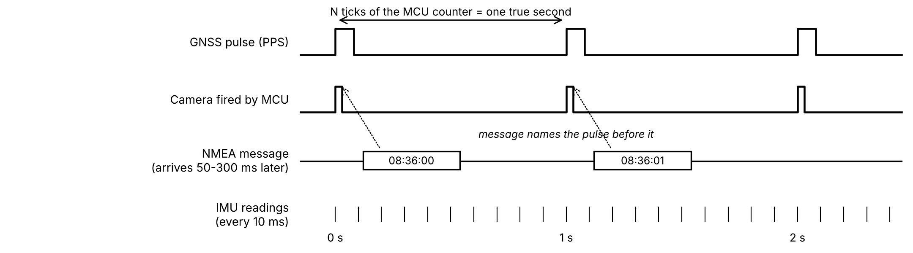

# Stratospheric Balloon Imaging Payload: Design Specification and Calculations

Author: Kuppala Sarath Narendra (B.Tech Electronics & Instrumentation, NIT Agartala)

This document covers the system design behind the simulations in this repo: architecture, timing scheme, data and telemetry budgets, fault handling, power, thermal design and the test plan. Every number in it comes from the calculations shown.

---

## 1. Mission and requirements

A box hangs under a stratospheric balloon with a 5 MP camera looking straight down (nadir). The camera takes **one photo every second**, from switch-on (1 hour before launch) until the balloon is cut down.

| ID | Requirement |
|---|---|
| R1 | Take and store every photo on board in real time, for the whole flight |
| R2 | Tag every photo with time (within **1 ms** of UTC), position and pointing |
| R3 | Send a thumbnail and health data to the ground at least once a minute |
| R4 | Survive any single fault without losing the mission |

## 2. Assumptions

| No. | Assumption |
|---|---|
| A1 | GNSS has a position fix before launch. A PPS pulse arrives every second; short dropouts may happen and are handled (Section 4.3). |
| A2 | The camera captures the whole frame at one instant and starts almost immediately when fired by a hardware signal. Exposure ≤ 0.5 ms; the middle of the exposure is stamped. |
| A3 | The NMEA message arrives 50–300 ms after its pulse and describes that pulse (time and position at the pulse). |
| A4 | Camera: 5 MP (5,000,000 pixels), 12 bits per pixel, 1 photo/s. |
| A5 | The MCU counter ticks about 1,000,000 times per second; the exact rate is measured from the PPS pulses. |
| A6 | The platform rotates no faster than 10°/s. |
| A7 | Telemetry: 115,200 baud, payload share 10%, downlink only. |
| A8 | "Real time" means each photo is saved on board as it is taken, with no backlog. The link is far too slow for full photos; the box is recovered after landing. |
| A9 | A "brief power loss" lasts up to 50 ms; anything longer is treated as a restart. |
| A10 | Box: 20 cm cube, 30 mm foam insulation. Launch from India, so the coldest air (about −80 °C) is at 16–17 km. |
| A11 | DC-DC converter: 9–36 V input, about 88% efficient. All times stored in UTC from GNSS (IST added on the ground). |

## 3. System architecture

*Solid lines: signals and data. Dashed lines: power. Dotted line: MCU switching parts on and off.*

The work is split between two processors:

- **MCU (microcontroller):** everything that must happen at an exact moment. It runs the timing counter, fires the camera, reads the GNSS PPS pulse and NMEA message, reads the IMU, monitors every part, and sends health data and the thumbnail to the ground.
- **OBC (on-board computer):** receives the full photos, writes each one to two SSDs and makes a thumbnail every minute.

Keeping timing on the MCU means the OBC's operating system can never add delay or jitter to a time stamp. Keeping telemetry on the MCU means health reports continue even while the OBC restarts.

All platform signals (PPS, NMEA, telemetry) use **RS-422** (differential, noise-immune). Recording starts on power-up, so no launch detection is needed.

## 4. Timing scheme (R2)

*Two seconds of operation (not to scale). The camera fires on the pulse; the NMEA message that follows names that pulse.*

### 4.1 How each photo gets its time, position and pointing

1. **Measure one second.** The MCU captures the counter value at every PPS pulse. **N** = ticks between pulses = the length of one true second in counter ticks (e.g. 1,000,020). N is re-measured every second. *(The simulations average N over the last 16 pulses.)*
2. **Fire the camera.** After each pulse, the MCU sets a hardware timer to fire the camera exactly N ticks later, which lands on the next pulse within about 1 µs. No software sits in the trigger path.
3. **Check the pulse.** The MCU watches a ±1 ms window around the expected tick. If the pulse arrives, it records its tick and updates N. If not, the photo has already been taken; it is flagged "no pulse" and the next one is scheduled with the last N. Nothing waits, so no delay is added.
4. **Confirm the photo.** The camera's strobe output goes high on capture; the MCU sees it and assigns a photo number.
5. **Add time and position.** 50–300 ms later the NMEA message arrives (e.g. "that pulse was 08:36:01 UTC at position X"). The MCU checks it equals the previous second + 1 and attaches it. The next pulse is still ≥ 700 ms away, so the message is always in time.
6. **Add pointing.** The IMU is read every 10 ms on the same counter. The latest reading (≤ 10 ms old) is attached. Pointing error ≤ 10°/s × 0.01 s = **0.1°**. All readings are also logged.
7. **Save.** The MCU sends one record per photo (number, time, position, pointing, flags) to the OBC, which saves it next to the photo on both SSDs.

**Worked example:** pulse at tick 5,000,000, N = 1,000,020 → camera fired at tick 6,000,020. Next pulse arrives at tick 6,000,021 (≈ 1 µs off). The NMEA message names it 08:36:01 UTC → photo time = 08:36:01.000 UTC + half the exposure.

### 4.2 Time error budget

| Source | Size | Reason |
|---|---|---|
| GNSS pulse accuracy | < 0.001 ms | PPS is accurate to under 1 µs |
| RS-422 receiver and cable | < 0.0001 ms | One receiver chip and a short cable |
| MCU counter step | 0.001 ms | One tick at 1 MHz |
| Planned firing vs. real pulse | ≈ 0.001 ms | N re-measured every second |
| Camera delay after firing | ≈ 0 | Assumption A2 |
| Exposure length | ≈ 0 | Middle stamped (≤ 0.25 ms even if not) |
| **Total** | **≈ 0.003 ms** | **> 300× inside the 1 ms requirement** |

### 4.3 Missing GNSS pulse (holdover)

The camera keeps firing every N ticks, so photos never stop (R1); they are flagged "no pulse". The heaters keep the MCU crystal near its ground temperature, so N stays steady. A 1 ppm drift adds 0.001 ms per second, reaching 1 ms only after about **1,000 s (≈ 16 min)** without any pulse. When the pulse returns, the MCU re-locks to it.

**Simulation results** (see the main [README](../README.md)): about 2 µs on a simulated Raspberry Pi Pico (Wokwi), and **10.8 µs worst case** through a 15-minute GNSS outage in a 6.5 h, 23,400-photo Python mission simulation.

## 5. Data and storage (R1)

| Item | Calculation | Result |
|---|---|---|
| One photo | 5,000,000 px × 12 bit ÷ 8 | **7.5 MB** |
| Photos per flight | (60 min pre-launch + 90 min ascent + 240 min float) × 60 s × 1/s | **23,400** |
| All photos | 23,400 × 7.5 MB | **175.5 GB** |
| With 30% margin | 175.5 GB × 1.3 | **228 GB** (fits 256 GB) |
| Write rate | 7.5 MB every second, to each SSD | **7.5 MB/s** |
| IMU log + photo records | 100/s × ~40 B × 23,400 s + ~200 B per photo | **≈ 98 MB** |

Every photo is written to **both** 256 GB SSDs (main and backup); either one alone holds the whole mission.

## 6. Telemetry: thumbnail and health (R3)

**Link budget:** 115,200 baud ÷ 10 bits per byte = 11,520 B/s. Payload share 10% = **1,152 B/s = 69,120 B/min**.

**Thumbnail:** every minute the OBC takes the latest photo, keeps one pixel of every 16 × 16 block (≈ 150 × 130 px), converts to 8-bit and JPEG-compresses it to **≈ 5 kB**. Send time = 5,000 ÷ 1,152 ≈ **4.3 s**. A full 7.5 MB photo would take 7,500,000 ÷ 1,152 ≈ 6,500 s (≈ 1 h 50 min), or 11 min even with the whole link, so only thumbnails go down.

**Usage:** 5,000 B (thumbnail) + 6 × 100 B (health every 10 s) = 5,600 B/min ≈ **8% of the share**.

**Packet format:** start marker · type · sequence number (detects lost packets) · data · check code (detects corrupted packets).

**Health data (collected once per second, 7 subsystems):**

| Part | How the MCU knows it works | Values sent |
|---|---|---|
| Camera | Strobe goes high after every firing | Photos taken, missed photos, restarts |
| SSDs | OBC reports write/read errors | Free space, errors, SSD in use |
| OBC | Heartbeat every second; none for 10 s = dead | Alive/restarted, restart count |
| GNSS | Pulse watched every second | Pulse present, fix valid, seconds without pulse |
| IMU | Read 100 times per second | Working / not working |
| Temperature | 5 sensors (camera, OBC, SSDs, converter, crystal) | 5 temperatures, heaters on/off |
| Power | Voltage and current at the input | Bus voltage, current |

## 7. Single-fault handling (R4)

Each part is recovered on its own; a full restart is the last resort. The MCU can power-cycle the camera, the OBC and each SSD through power switches, and every processor has its own watchdog timer.

| Fault | Detection | Response | Loss |
|---|---|---|---|
| Camera hang | No strobe after firing | MCU power-cycles the camera | A few seconds of photos |
| Storage error | OBC sees write/read error | Continue on backup SSD (already has every photo); power-cycle main SSD and retry | Nothing |
| Brief power loss | MCU measures input voltage | ≤ 50 ms: capacitors ride through. Longer: automatic restart, watchdogs bring every processor back, recording resumes in < 1 min in a new folder with correct GNSS time | Nothing, or < 1 min |
| OBC freeze | No heartbeat for 10 s | OBC watchdog restarts it; else MCU power-cycles it | < 1 min |
| MCU freeze | MCU watchdog | MCU restarts in a fraction of a second | Almost nothing |
| GNSS pulse lost | No pulse in window | Keep firing every N ticks, flag "no pulse" (4.3) | Nothing |

## 8. Power

**Power path:** 28 V line (22–32 V) → 3 A fuse → surge clamp + filter → 4.7 mF capacitors → DC-DC 28 V → 5 V → power switches → camera, OBC, SSDs. A small 3.3 V regulator feeds the MCU, IMU and sensors. The two heaters run straight from 28 V through a switch.

- **Fuse:** a fault inside the box cannot pull down the platform's power.
- **Surge clamp + filter:** blocks incoming spikes and keeps the payload's noise off the shared line.
- **DC-DC instead of a linear regulator:** 28 V → 5 V linear would turn 82% of the power into heat; the DC-DC wastes about 12%.
- **Hold-up capacitors:** C = 2 × P × t ÷ (V_start² − V_end²) = 2 × 14 W × 0.05 s ÷ (22² − 9²) = 1.4 ÷ 403 = **3.5 mF → 4.7 mF used**.

### 8.1 Power budget per phase

| Load (W) | Pre-launch (1 h) | Ascent (1.5 h) | Float (4 h) | Descent (0.67 h) |
|---|---|---|---|---|
| Camera | 3.0 | 3.0 | 3.0 | 0 (off) |
| OBC | 5.0 | 5.0 | 5.0 | 2.5 |
| Two SSDs (both writing) | 3.0 | 3.0 | 3.0 | 0 (off) |
| MCU, IMU, sensors, RS-422 | 1.1 | 1.1 | 1.1 | 1.1 |
| **Electronics** | 12.1 | 12.1 | 12.1 | 3.6 |
| From 28 V line (÷ 0.88) | 13.8 | 13.8 | 13.8 | 4.1 |
| Heaters (average) | 0 | 6.0 | 6.0 | 6.0 |
| **Total** | 13.8 | 19.8 | 19.8 | 10.1 |
| **With 25% margin** | 17.3 | 24.8 | 24.8 | 12.6 |
| **Energy** | 17.3 Wh | 37.1 Wh | 99.0 Wh | 8.4 Wh |

**Total energy ≈ 162 Wh.**

**Fuse sizing:** worst case = everything on + both heaters fully on (2 × 6 W): (13.8 + 12) × 1.25 = 32.3 W. Current is highest at the lowest bus voltage: 32.3 ÷ 22 V = **1.47 A → 3 A fuse**.

## 9. Thermal design

Outside air goes from about +30 °C on the ground to about −80 °C at 16–17 km, and about −57 °C at 20 km float, where air is ~20× thinner and removes very little heat.

- **Insulation:** 30 mm foam on all six faces, opening only for the lens; white outer paint to reflect sunlight.
- **Aluminium floor:** all parts mounted on a 3–4 mm aluminium 6061 plate so hot parts (OBC, converter) warm the parts that must stay warm (camera, crystal).
- **Heaters:** two 6 W elements from 28 V, switched by the MCU as a thermostat using the 5 temperature sensors, holding about 25 °C inside (this also keeps the crystal near its ground temperature, Section 4.3).
- **Warm start:** box pre-warmed to about 30 °C before launch.

**Check:**

- Heat leak through foam = 0.03 W/m·K × 0.24 m² ÷ 0.03 m = **0.24 W per °C** of difference.
- Float (−57 °C): 0.24 × 82 = 19.7 W needed. Electronics give 13.8 W → heaters add **≈ 6 W**.
- Coldest air (−80 °C): 0.24 × 105 = 25.2 W needed → heaters add **≈ 11.4 W** (12 W available).
- Thermal time constant ≈ 3 kg × 900 J/kg·K ÷ 0.24 W/°C ≈ 11,250 s ≈ **3 h**, much longer than the 20–30 min spent in the coldest air.
- Too warm: without sun, the inside settles about 57 °C above outside air (13.8 ÷ 0.24), which is fine at float. On the ground the box is kept in shade; heaters stay off whenever the inside is above 25 °C.

## 10. Environment from launch to recovery

| Phase | What happens | Mitigation |
|---|---|---|
| Ground | Heat, sun, humidity | Shade; moisture absorber packets inside |
| Launch | Jerk, swinging | Everything screwed down; locking connectors |
| Ascent | Down to −80 °C, pressure drop, most vibration | Heaters, warm start, small vent hole for pressure equalisation |
| Float | Thin air, strong sun | White paint, thermostat heaters; SSDs (no spinning disks) |
| Descent | Parachute jerk, tumbling, damp air | Before cut-down: files closed, camera and SSDs switched off |
| Landing | ~5 m/s impact, lens first | Lens set back behind a foam guard ring; SSDs on soft mounts |
| Recovery | May take hours | Contact label on the box; copy both SSDs first |

## 11. Test and trial plan

### 11.1 Sequence

1. **Unit bench tests:** camera fires and strobe returns; MCU reads pulses and messages; IMU readings; SSD write/read; converter gives 5 V from 22–32 V input.
2. **System bench test** with a GNSS receiver supplying PPS and NMEA; check every photo gets time, position and pointing.
3. **Timing check:** an LED flashing on each PPS pulse is placed in front of the camera. If the photos show the LED lit, the photo was taken on the pulse.
4. **Fault injection:** unplug the camera, pull the main SSD, cut power for 50 ms and for 10 s, remove the pulse, stop the OBC. The system must recover by itself every time.
5. **Cold and low-pressure test:** 6 h in a chamber at −80 °C and very low pressure; check temperatures and that N stays steady.
6. **Endurance run:** 8 h non-stop (> 6.5 h needed); all photos present on both SSDs.
7. **Record reference N** on the ground at room temperature for the flight.
8. **Platform fit check:** power, pulse, messages, and telemetry reaching the ground station.

### 11.2 Pre-launch

- **Self-check program:** a Python script checks the MCU, OBC, camera (test photo + strobe), both SSDs (write/read), GNSS pulse and message, IMU, temperature sensors, heaters, input voltage and telemetry, printing PASS/FAIL for each.
- **Crystal check:** compare the measured N with the ground reference.
- **Launch only if every item says PASS.**

| Time | Activity |
|---|---|
| T − 2 h | Mount the box; connect power, pulse, message and telemetry |
| T − 1 h | Switch on; warm to ~30 °C; check thumbnails reach the ground station |
| T − 30 min | Run the self-check program; check N |
| T − 10 min | Remove lens cap; launch only if all checks PASS |
| Flight | Watch health data and the thumbnail every minute |
| After landing | Recover the box, copy both SSDs, then analyse the photos |
